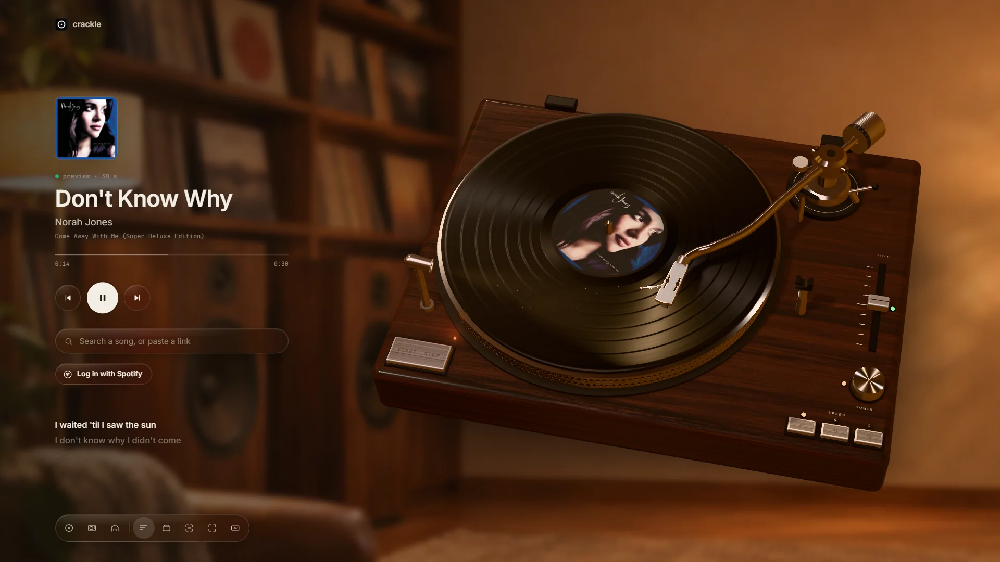
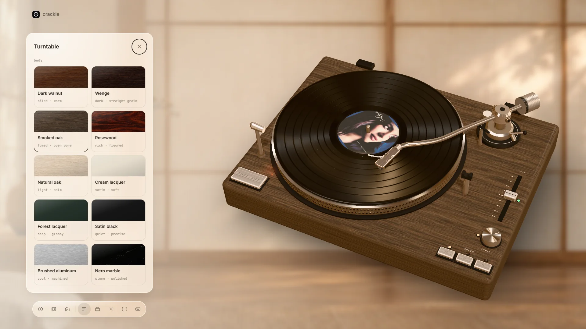
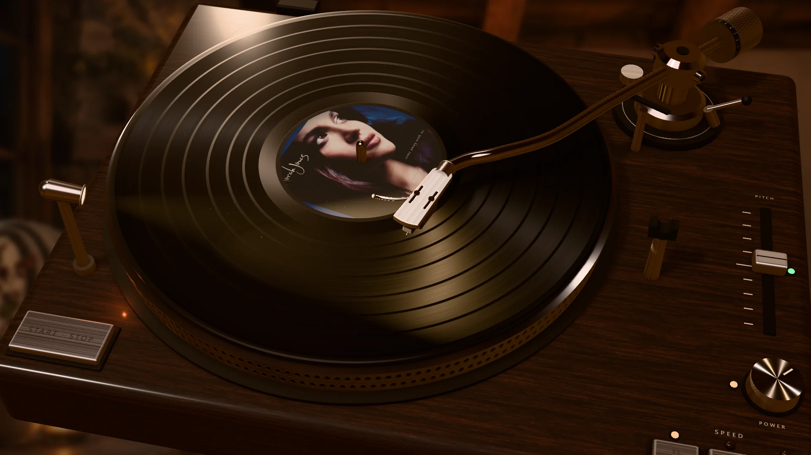
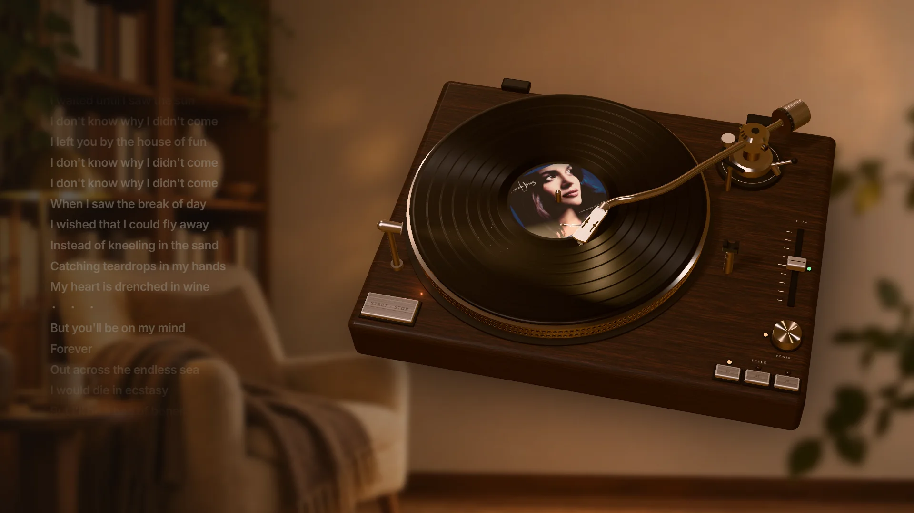
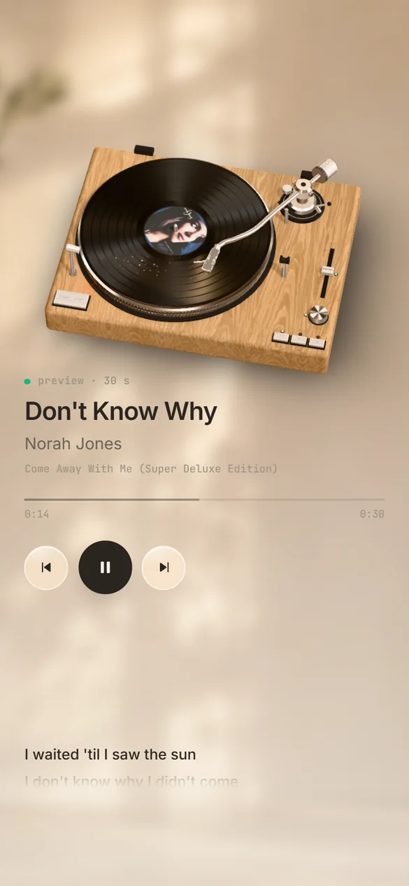

<div align="center">


# Crackle

A photoreal turntable for the big screen. Put it on a TV, play something slow, let the record turn.

[**Open Crackle**](https://eco-null.github.io/crackle/) · Spotify · YouTube · your own files · synced lyrics



</div>

## Why

I wanted the feeling of a record player in the room while music plays from a streaming app, on the TV, without a busy music UI in the way. So I built one: a real-time 3D turntable at real scale that follows whatever is playing. It is free, open source and runs in the browser. Nothing to install.

## What it does

**A turntable that behaves like one**

- The platter spins up under torque and coasts down. The tonearm lifts on its cue, travels on a smooth curve, sets down on the lead-in and tracks inward with the song. It cues up when you pause and returns to its rest when you stop.
- Drag the arm anywhere on the record to seek.
- When the album changes, the arm parks, the platter stops, and the record lifts off and is replaced. The cover art is printed on the label and turns with the record.
- A pop-up stylus lamp rakes a warm V of light across the grooves toward the needle, with a little dust drifting in the beam.
- 33⅓, 45 and 78 rpm, pitch fader, dust cover.

**Lit by the room it is in**

Each room photo also lights the deck. The photo becomes the reflection environment, and the light rig reads where the photo's window, lamp or fire is, plus its colour and brightness. In a sunny room the chrome catches the window; by the fireplace the wood glows amber and the light flickers. Some rooms add what a photo cannot say: low sun through wooden blinds lays stripes across the deck in the seventies room, olive leaves throw small shadows on the coast, and the neon room lights it magenta from one side and cyan from the other.



**Bodies, layouts, pressings, rooms**

- 10 bodies: dark walnut, wenge, smoked oak, rosewood, natural oak, cream lacquer, forest lacquer, satin black, brushed aluminium, Nero marble.
- 3 control layouts: classic (speed buttons in a front row), studio (speeds and a long pitch fader under the right hand, a big volume dial behind the platter) and minimal (a round start button, a rotary speed selector and one large dial).
- 4 hardware finishes, set separately from the body: silver, black, brass, gunmetal.
- 9 pressings: black, smoke, oxblood, amber, cream, marble, splatter, cover-coloured, picture disc.
- 18 rooms: plain, morning, japandi, sunroom, coast, snow cabin, loft, concrete, seventies, desert, rain, reading nook, library, listening room, late bar, fireplace, city night, neon.

Settings open beside the deck, not over it, so you see every change as you make it.

**Focus mode**

Only the record. Scroll to move in close to the needle. One button brings the lyrics back on the left, and nothing else.





## Sources

| Source | What it plays | Needs |
| --- | --- | --- |
| Spotify | Full songs in the browser with Premium. Without Premium it follows whatever your Spotify app is playing. | A Spotify account |
| YouTube | Search results, video or playlist links. Live streams spin forever. | Nothing |
| Previews | 30-second previews of any song, shown when Spotify is not connected | Nothing |
| Files | Audio files you pick or drop on the page | Nothing |

Search covers Spotify (when connected) and YouTube in one box. Synced lyrics come from [LRCLIB](https://lrclib.net).

With Spotify it works like the app:
- **Your library in the search box.** Click into it with nothing typed and your playlists, saved albums and Liked Songs are there; typing finds them first, then songs, artists, albums and playlists.
- **Links.** Paste any Spotify link (song, album, playlist, artist) or a YouTube link and it plays.
- **A queue.** Right-click a result, press its **+** or Shift+Enter to add it; the queue button in the dock (or Q) shows what plays next. Next skips to the queue first.
- **It keeps playing.** When an album, a playlist or a single song runs out, more songs around the artist follow, so the music doesn't stop.

Accounts connected before the library arrived need to connect once more to show their playlists.

YouTube videos play in a small card you can drag anywhere. Two optional settings in **Sources → YouTube**, both off by default:
- **In place of the cover:** the video takes the cover's spot in the panel.
- **Ghost video:** at full zoom in focus mode, the clip floats see-through over the record. This places the page in front of YouTube's player, which YouTube's embed policies don't allow, so it stays opt-in.



## Made for a TV

- Controls and cursor hide after a few seconds. On a remote, the first arrow press brings them back.
- The screen stays awake while music plays.
- The camera drifts very slowly, so no pixel holds the same image for long (kind to OLED panels).
- When the record is stopped it renders at half rate, and shadows redraw only when something moves.
- Works from phone to ultrawide.

<br clear="right">

## Keys

| Key | Action | Key | Action |
| --- | --- | --- | --- |
| Space | Play / pause | F | Focus mode |
| ← → | Previous / next | L | Lyrics |
| / | Search | Wheel, 0 | Zoom in focus mode, reset |
| M, Shift+M | Next / previous body | C | Dust cover |
| V | Next pressing | 3 4 7 | 33⅓ / 45 / 78 rpm |
| R | Next room | Enter | Full screen |
| S | Sources | Esc | Close a panel |
| Q | Queue | Shift+Enter | Add the selected result to the queue |

## Install it as an app

Crackle is a web app you can install: in Chrome or Edge press the install button in the dock (or the icon in the address bar), on Android use **Add to Home screen**, on iPhone and iPad **Share → Add to Home Screen**. It opens in its own window without browser chrome, and it opens even without a connection (music still needs one).

## Run it yourself

No build step, no dependencies.

```bash
git clone https://github.com/eco-null/crackle.git
cd crackle
npm start            # serves on http://127.0.0.1:5173
```

Any static file server works too. It is plain HTML, CSS and ES modules.

### Spotify

Spotify login uses PKCE in the browser, so there is no server and no secret.

1. Create an app at the [Spotify developer dashboard](https://developer.spotify.com/dashboard).
2. Add your redirect URI exactly: `http://127.0.0.1:5173/` locally (Spotify rejects `localhost`), or your hosted address such as `https://you.github.io/crackle/`.
3. Tick **Web API** and **Web Playback SDK**.
4. Put the client ID in `js/config.js`, or paste it in **Sources → Spotify**.

Apps in Spotify's development mode only accept accounts added under **User Management**. If you host your own copy, use your own client ID.

Playing inside the browser needs Premium and a browser with DRM (Chrome, Edge, Firefox, Safari). Elsewhere, songs start in your Spotify app and the turntable follows.

### YouTube search

Search uses public [Piped](https://github.com/TeamPiped/Piped) mirrors, which are sometimes down. For a reliable route, add a YouTube Data API v3 key (restricted to your site's address) as `YOUTUBE_API_KEY` in `js/config.js`.

## How it's built

- **three.js 0.170** from jsDelivr, no bundler. Physically based materials with anisotropic brushed metal, clear-coated lacquer, knurled normals and a generated groove normal map. VSM soft shadows, ground-truth ambient occlusion, neutral tone mapping.
- **Real scale in centimetres:** 12" record, 23 cm tonearm with 22° offset, lead-in at 14.75 cm, run-out at 6.4 cm.
- **Motion:** quintic minimum-jerk arm travel, hydraulic cue descent, torque-limited platter, critically damped springs for knobs, faders and lid.
- **Adaptive quality:** if frames run slow for a few seconds, the pixel ratio drops, then post-processing switches off.

```
index.html        page and controls
css/app.css       layout, glass, themes
js/deck3d.js      the 3D turntable: model, materials, lighting, motion
js/app.js         state, search, panels, keys
js/materials.js   bodies, pressings, hardware, rooms
js/sources/       spotify.js, youtube.js, local.js
js/lyrics.js      LRCLIB lookup
```

## Credits

- Room photos and the wenge, smoked oak and marble textures were generated for this project with Codex.
- Wood scans and the studio HDRI: [Poly Haven](https://polyhaven.com) (CC0), loaded from its CDN.
- Record grooves, label paper, strobe dots and knurling are generated in code.
- Lyrics: [LRCLIB](https://lrclib.net). Previews: iTunes Search API.

## License

[MIT](LICENSE) © eco-null
